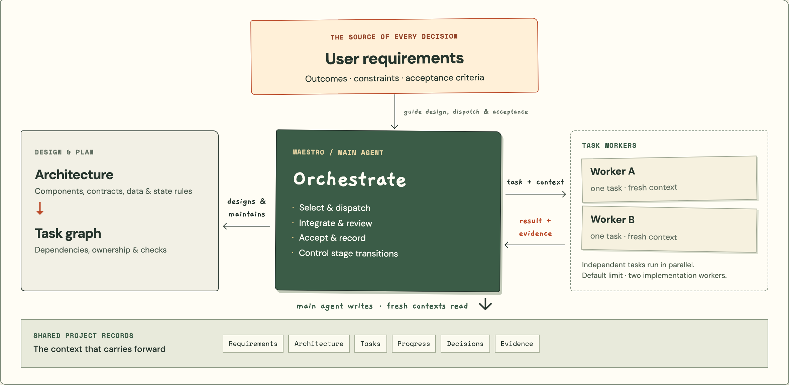

<div align="center">

**English** &nbsp; · &nbsp; [简体中文](README.zh-CN.md)

✳ &nbsp; **M A E S T R O** &nbsp; ✳

# Maestro

**Requirement-driven orchestration for complex software development.**

Architecture, development planning, tiered subagents, and stage control — connected through durable project records.

[Explore the illustrated guide ↗](https://jay201368.github.io/maestro/) &nbsp; · &nbsp; [Install](#install) &nbsp; · &nbsp; [Read the skill](SKILL.md)

</div>

---

## Start with the user's requirements

Complex development often spans more work than a single conversation can retain. Architecture decisions, dependencies, acceptance criteria, and unfinished work all need to survive context changes.

Maestro is a Codex orchestration skill that organizes this work into a software engineering process. The user's requirements drive the architecture, the development plan, and the acceptance criteria. Project documents preserve the current contracts and delivery state, so fresh subagents can pick up bounded tasks and the main agent can resume coordination from recorded evidence.

## Clarify the requirements together

Maestro includes a grilling-style discussion before a new project, stage, or material requirement change. It maps dependent decisions, asks every currently answerable question in a round, and recommends an answer for each. Fresh investigators look up repository facts while the user decides product tradeoffs.

Once the relevant branches are resolved, Maestro summarizes the shared understanding for explicit user confirmation. That agreement drives initialization, architecture design and task planning. Confirmed conclusions carry into small changes and resumed work; new ambiguity reopens the affected branches. The protocol is bundled with Maestro.

## How the system fits together



The main agent maintains the architecture and dependency plan, dispatches bounded work, and accepts results. Shared project records provide the context for each fresh worker and resumed session.

## Follow one stage


- **Discuss and confirm** the requirements before initialization. Resolve the relevant decision tree and confirm the shared understanding.
- **Plan** the architecture and task graph from that agreement before dispatch.
- **Execute** dependency-ready tasks with a fresh worker each time. Diagnose failed acceptance and retry the same task. Record and commit accepted work, then select the next ready task.
- **Close** the stage after reviewing its outcomes and resolving unfinished requirements through completion or an explicitly approved scope change. Confirm closure, archive the handoff, and plan the next stage.

Create a Git checkpoint after each task acceptance and workflow initialization, change, or archival operation.

## How execution stays coordinated

The main agent owns architecture decisions, scheduling, shared records, integration, and final acceptance. Each worker owns one task and reports its result against the agreed criteria. Independent tasks can run in parallel, with a default limit of two implementation workers. Coupled work follows its dependency order.

Worker selection considers complexity, uncertainty, and the consequences of failure. The bundled configurations are:

| Model | Reasoning levels | Typical work |
| --- | --- | --- |
| Luna | max | Bounded routine implementation and focused investigation |
| Sol | medium · high · xhigh · max | Defined implementation, integration, state handling, and difficult debugging |
| Astra | medium · high · xhigh · max | Design uncertainty, cross-system reasoning, and coupled architectural problems |

A complex task can start with a stronger configuration. Failed acceptance first triggers diagnosis of the requirement, environment, implementation, or reasoning issue. See the [routing guide](references/worker-routing.md) for selection and correction rules.

## Continue across context boundaries

The requirements record preserves the confirmed discussion outcome and its approval source. Unfinished discussions can carry forward through a concise handoff of settled decisions, open questions and pending investigations.

A fresh worker receives the relevant project documents, a complete task card, owned files, dependency evidence, and its verification plan. A resumed main agent reconciles the records with the current repository before scheduling further work.

| Persistent context | Purpose |
| --- | --- |
| Architecture and decisions | Carry current system contracts and durable rationale across stages |
| Stage requirements and tasks | Preserve scope, requirement coverage, dependencies, and acceptance criteria |
| Progress and acceptance records | Track what is complete, active, blocked, and supported by evidence |
| Archived stages and handoffs | Preserve delivered behavior, changes, open items, and inputs to the next stage |

Verification follows the risk of the change. Applicable evidence can be reused across worker review and stage acceptance. The main agent reviews requirement coverage and evidence validity alongside structural checks. See the [document contracts](references/document-contracts.md) for the complete lifecycle.

## Install

Clone the repository into your Codex skills directory, then install the worker profiles.

```bash
git clone https://github.com/JAY201368/maestro.git ~/.codex/skills/maestro
mkdir -p ~/.codex/agents
cp ~/.codex/skills/maestro/assets/worker-profiles/*.toml ~/.codex/agents/
```

Start a new chat after installing or updating the profiles so Codex can discover them. Invoke the skill with:

```text
$maestro
```

Describe the outcome you need and provide existing requirements or project documents. Maestro starts by clarifying unresolved decisions with you and confirming the shared understanding. Maestro can adapt to the repository's document paths. Available models and effective runtime settings depend on your Codex environment.

## Repository contents

| Path | What it contains |
| --- | --- |
| [SKILL.md](SKILL.md) | The orchestration workflow and control rules |
| [references/](references/) | Document contracts and worker routing guidance |
| [assets/templates/](assets/templates/) | Starter documents for stage planning and execution |
| [assets/worker-profiles/](assets/worker-profiles/) | Nine custom worker configurations |
| [scripts/](scripts/) | Helpers to initialize, validate, and archive stage records |

---

<div align="center">

[Illustrated guide ↗](https://jay201368.github.io/maestro/) &nbsp; · &nbsp; [MIT License](LICENSE)

</div>
