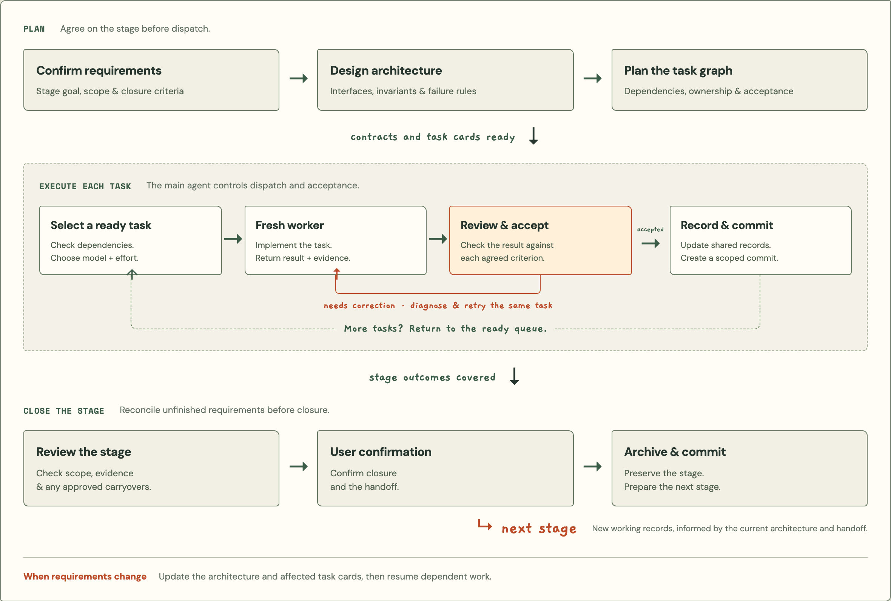

<div align="center">

[English](README.md) &nbsp; · &nbsp; **简体中文**

✳ &nbsp; **M A E S T R O** &nbsp; ✳

# Maestro

**面向复杂软件开发的需求驱动编排。**

架构、开发规划、分层子代理与阶段控制 —— 通过持久化的项目记录彼此衔接。

[浏览图解指南 ↗](https://jay201368.github.io/maestro/index.zh-CN.html) &nbsp; · &nbsp; [安装](#install) &nbsp; · &nbsp; [阅读技能说明](SKILL.md)

</div>

---

## 从用户的需求出发

复杂的开发工作往往超出单次对话所能承载的体量。架构决策、依赖关系、验收标准以及未完成的工作，都必须能够跨越上下文的更替而留存下来。

Maestro 是一个 Codex 编排技能，它把这类工作组织成一套软件工程流程。用户的需求驱动架构、开发计划与验收标准。项目文档保存当前的契约与交付状态，使全新的子代理能够接手边界明确的任务，主代理也能依据记录在案的证据恢复协调工作。

## 共同澄清需求

在新项目、新阶段或需求的重大变更开始之前，Maestro 会先进行一次追问式讨论（grilling）。它会梳理出彼此依赖的决策，在一轮中提出所有当前可以回答的问题，并为每个问题推荐答案。全新的调查者负责查证仓库中的事实，而由用户决定产品层面的取舍。

当相关分支都得到解决之后，Maestro 会总结出共识理解，交由用户明确确认。这份共识驱动初始化、架构设计与任务规划。已确认的结论会延续到小改动与恢复的工作中；出现新的歧义时，则重新打开受影响的分支。该协议随 Maestro 一并提供。

## 系统如何协同运作


主代理维护架构与依赖计划，分派边界清晰的工作，并验收结果。共享的项目记录为每一个全新的执行者和每一次恢复的会话提供上下文。

## 跟随一个阶段



- 在初始化之前**讨论并确认**需求。解决相关的决策树，并确认共识理解。
- 在分派之前，依据该共识**规划**架构与任务图。
- **执行**依赖已就绪的任务，每一次都使用全新的执行者。对未通过验收的任务进行诊断，并重试同一任务。记录并提交已验收的工作，然后选择下一个就绪任务。
- 在审查阶段成果、并通过完成或经明确批准的范围变更解决未完成需求之后，**关闭**该阶段。确认关闭，归档交接材料，并规划下一个阶段。

每次任务验收之后，以及每次工作流初始化、变更或归档操作之后，都要创建一个 Git 检查点。

## 执行如何保持协调

主代理负责架构决策、调度、共享记录、集成与最终验收。每个执行者只负责一个任务，并按照约定标准报告其结果。相互独立的任务可以并行执行，默认上限为两个实现类执行者。彼此耦合的工作则遵循依赖顺序。

执行者的选择会综合考虑复杂度、不确定性与失败的后果。随附的配置如下：

| 模型 | 推理等级 | 典型工作 |
| --- | --- | --- |
| Luna | max | 边界明确的日常实现与聚焦式调查 |
| Sol | medium · high · xhigh · max | 定义清晰的实现、集成、状态处理与疑难调试 |
| Astra | medium · high · xhigh · max | 设计上的不确定性、跨系统推理与相互耦合的架构问题 |

复杂任务可以从更强的配置起步。验收失败时，首先诊断问题出在需求、环境、实现还是推理层面。关于选择与纠正规则，请参见[执行者路由指南](references/worker-routing.md)。

## 跨越上下文边界继续推进

需求记录保存已确认的讨论结果及其批准来源。尚未完成的讨论可以通过一份简明的交接材料延续下去，其中包含已定决策、未决问题与待进行的调查。

全新的执行者会收到相关的项目文档、一份完整的任务卡、其所拥有的文件、依赖证据以及验证计划。恢复工作的主代理会先将记录与当前仓库核对一致，然后再安排后续工作。

| 持久化上下文 | 用途 |
| --- | --- |
| 架构与决策 | 跨阶段传递当前的系统契约与持久的决策依据 |
| 阶段需求与任务 | 保存范围、需求覆盖情况、依赖关系与验收标准 |
| 进度与验收记录 | 跟踪哪些工作已完成、进行中、被阻塞，以及有哪些证据支撑 |
| 已归档的阶段与交接 | 保留已交付的行为、变更、遗留事项，以及下一个阶段的输入 |

验证力度与变更的风险相匹配。适用的证据可以在执行者评审与阶段验收之间复用。主代理会在结构检查之外，审查需求覆盖情况与证据有效性。完整生命周期请参见[文档契约](references/document-contracts.md)。

<a id="install"></a>

## 安装

将仓库克隆到你的 Codex 技能目录，然后安装执行者配置。

```bash
git clone https://github.com/JAY201368/maestro.git ~/.codex/skills/maestro
mkdir -p ~/.codex/agents
cp ~/.codex/skills/maestro/assets/worker-profiles/*.toml ~/.codex/agents/
```

安装或更新配置之后，请新建一个会话，以便 Codex 能够发现它们。使用以下方式调用该技能：

```text
$maestro
```

描述你期望的结果，并提供已有的需求或项目文档。Maestro 会先与你澄清尚未确定的决策，并确认共识理解。Maestro 可以适配仓库现有的文档路径。可用的模型与生效的运行时设置取决于你的 Codex 环境。

## 仓库内容

| 路径 | 内容 |
| --- | --- |
| [SKILL.md](SKILL.md) | 编排工作流与控制规则 |
| [references/](references/) | 文档契约与执行者路由指南 |
| [assets/templates/](assets/templates/) | 用于阶段规划与执行的起始文档模板 |
| [assets/worker-profiles/](assets/worker-profiles/) | 九个自定义执行者配置 |
| [scripts/](scripts/) | 用于初始化、校验与归档阶段记录的辅助脚本 |

---

<div align="center">

[图解指南 ↗](https://jay201368.github.io/maestro/index.zh-CN.html) &nbsp; · &nbsp; [MIT 许可证](LICENSE)

</div>
