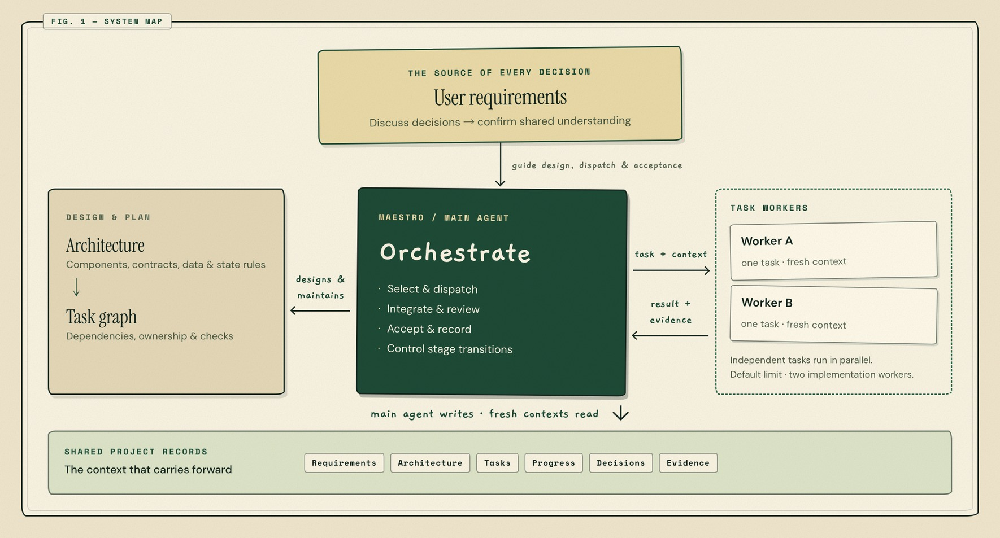
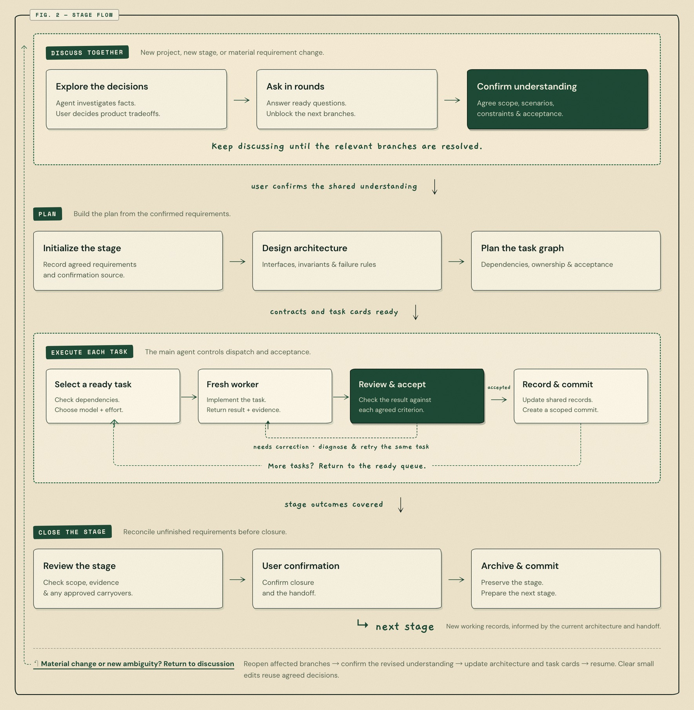

<div align="center">

[English](README.md) &nbsp; · &nbsp; **简体中文**

✳ &nbsp; **M A E S T R O** &nbsp; ✳

# Maestro

**面向复杂软件开发的需求驱动编排。**

架构、开发规划、分层子代理和阶段控制，通过持久化的项目记录连成一体。

[浏览图解指南 ↗](https://jay201368.github.io/maestro/index.zh-CN.html) &nbsp; · &nbsp; [安装](#install) &nbsp; · &nbsp; [阅读技能说明](SKILL.md)

</div>

---

## 从用户的需求出发

复杂的开发工作，往往超出单次对话能承载的范围。架构决策、依赖关系、验收标准以及尚未完成的工作，都必须在上下文更替之后保留下来。

Maestro 是一个 Codex 编排技能，它把这类工作组织成一套软件工程流程。用户的需求决定架构、开发计划与验收标准。项目文档保存当前的契约与交付状态，让新的子代理能接手边界明确的任务，也让主代理能依据记录在案的证据继续协调工作。

## 共同澄清需求

在新项目、新阶段开始之前，或者需求发生重大变更时，Maestro 会先进行一次追问式讨论（grilling）。它会梳理出彼此依赖的决策，一次性提出所有目前可以回答的问题，并为每个问题推荐答案。负责调查的代理会查证仓库中的事实，产品层面的取舍则由用户决定。

相关的决策分支都有结论之后，Maestro 会总结出共识，请用户明确确认。这份共识是初始化、架构设计与任务规划的依据。已确认的结论会沿用到小改动和恢复的工作中；一旦出现新的歧义，就重新打开受影响的分支。该协议随 Maestro 一并提供。

## 系统如何协同运作



主代理维护架构和依赖计划，分派边界清晰的工作，并验收结果。共享的项目记录为每个新执行者和每次恢复的会话提供上下文。

## 一个阶段怎么走



- 在初始化之前**讨论并确认**需求：把相关的决策树讨论清楚，并确认双方理解一致。
- 在分派之前，依据这份共识**设计**架构、**规划**任务图。
- **执行**依赖已经就绪的任务，每次都用新的执行者。未通过验收的任务，先诊断原因，再重试同一任务。记录并提交已验收的工作，然后选择下一个就绪任务。
- 审查阶段成果，逐项处理未完成的需求：能完成的直接完成，需要调整范围的则先取得明确批准，然后**结束**该阶段。确认结束后，归档交接材料，并规划下一阶段。

每完成一次任务验收，以及每次初始化、变更或归档工作流之后，都要创建一个 Git 检查点。

## 执行过程中如何保持协调

主代理负责架构决策、调度、共享记录、集成和最终验收。每个执行者只负责一个任务，并按约定标准报告结果。相互独立的任务可以并行执行，默认最多同时运行两个实现执行者。彼此耦合的工作则按依赖顺序进行。

执行者的选择会综合考虑复杂度、不确定性与失败代价。随附的配置如下：

| 模型 | 推理等级 | 典型工作 |
| --- | --- | --- |
| Luna | max | 边界清晰的日常实现与专项调查 |
| Sol | medium · high · xhigh · max | 定义清晰的实现、集成、状态处理与疑难调试 |
| Astra | medium · high · xhigh · max | 设计不确定性、跨系统推理和相互耦合的架构问题 |

复杂任务可以从更强的配置起步。验收失败时，首先诊断问题出在需求、环境、实现还是推理层面。关于执行者的选择与纠错规则，请参见[执行者路由指南](references/worker-routing.md)。

## 上下文更替后继续推进

需求记录保存已确认的讨论结果和确认依据。尚未完成的讨论可以通过一份简明的交接材料延续下去，其中包括已定决策、未决问题和待查证的事项。

新的执行者会收到相关的项目文档、一份完整的任务卡、自己负责的文件、依赖证据以及验证计划。恢复工作的主代理会先把记录与当前仓库核对一致，再安排后续工作。

| 持久化上下文 | 用途 |
| --- | --- |
| 架构与决策 | 跨阶段传递当前的系统契约与持久的决策依据 |
| 阶段需求与任务 | 保存范围、需求覆盖情况、依赖关系与验收标准 |
| 进度与验收记录 | 跟踪哪些工作已完成、正在进行或被阻塞，以及有哪些证据支撑 |
| 已归档的阶段与交接 | 保留已交付的功能、变更、遗留事项，以及下一阶段的输入 |

验证力度与变更风险相匹配。适用的证据可以在执行者评审和阶段验收之间复用。主代理除了检查结构，还会审查需求覆盖情况与证据是否有效。完整生命周期请参见[文档契约](references/document-contracts.md)。

<a id="install"></a>

## 安装

将仓库克隆到你的 Codex 技能目录，然后安装执行者配置。

```bash
git clone https://github.com/JAY201368/maestro.git ~/.codex/skills/maestro
mkdir -p ~/.codex/agents
cp ~/.codex/skills/maestro/assets/worker-profiles/*.toml ~/.codex/agents/
```

安装或更新配置后，请新建一个会话，以便 Codex 能识别这些配置。使用以下方式调用该技能：

```text
$maestro
```

描述你期望的结果，并提供已有的需求或项目文档。Maestro 会先和你一起澄清尚未确定的决策，再确认共识。Maestro 可以适配仓库现有的文档路径。可用的模型和运行时设置取决于你的 Codex 环境。

## 仓库内容

| 路径 | 内容 |
| --- | --- |
| [SKILL.md](SKILL.md) | 编排工作流与控制规则 |
| [references/](references/) | 文档契约与执行者路由指南 |
| [assets/templates/](assets/templates/) | 用于阶段规划与执行的起始文档模板 |
| [assets/worker-profiles/](assets/worker-profiles/) | 九个自定义执行者配置 |
| [scripts/](scripts/) | 用于初始化、校验与归档阶段记录的辅助脚本 |

---

<div align="center">

[图解指南 ↗](https://jay201368.github.io/maestro/index.zh-CN.html) &nbsp; · &nbsp; [MIT 许可证](LICENSE)

</div>
