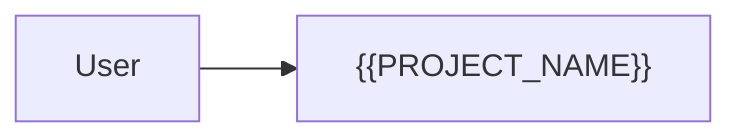

# {{PROJECT_NAME}} Architecture

## 1. Goals and boundaries

- TODO: users, observable outcomes, and constraints derived from `requirement.md`.
- Out of scope: TODO.

## 2. Quality attributes and technology choices

| Area | Choice | Responsibility / rationale |
| --- | --- | --- |
| TODO | TODO | TODO |

## 3. System context and data flows

### 3.1 Primary flow

1. TODO.

### 3.2 Failure and concurrency rules

- TODO.

## 4. Module boundaries

| Module | Owns | Must not own |
| --- | --- | --- |
| TODO | TODO | TODO |

## 5. Data model and invariants

| Entity | Key fields | Constraints and lifecycle |
| --- | --- | --- |
| TODO | TODO | TODO |

## 6. Public contracts

### 6.1 Common conventions

- TODO: versioning, authentication, serialization, errors, and idempotency.

### 6.2 Interfaces

| Method / event | Authorization | Request and result |
| --- | --- | --- |
| TODO | TODO | TODO |

## 7. Security and privacy

- TODO: trust boundaries, secrets, private data, validation, and audit.

## 8. Deployment, operations, and verification

- TODO: topology, configuration, persistence, health, logs, scaling, tests, and mock limits.
